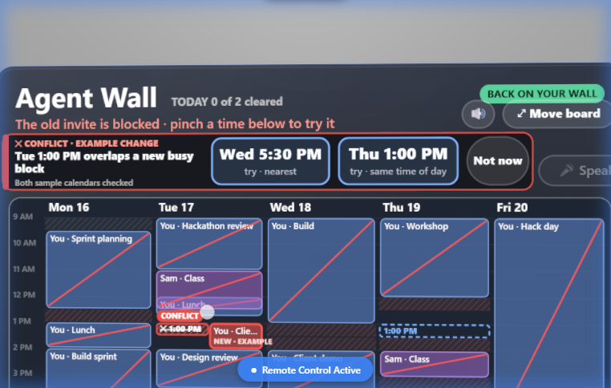
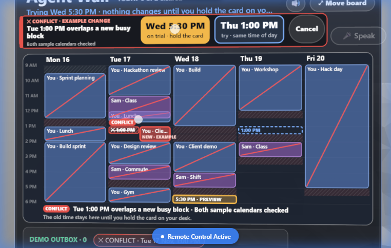
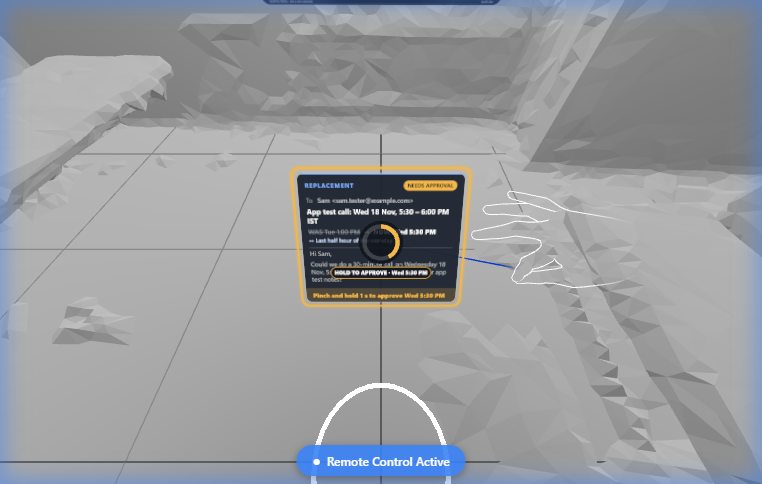
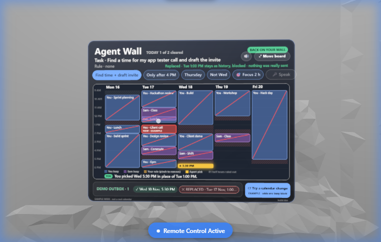
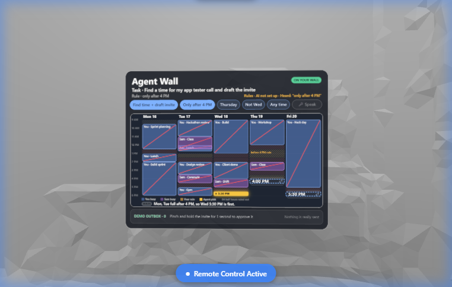
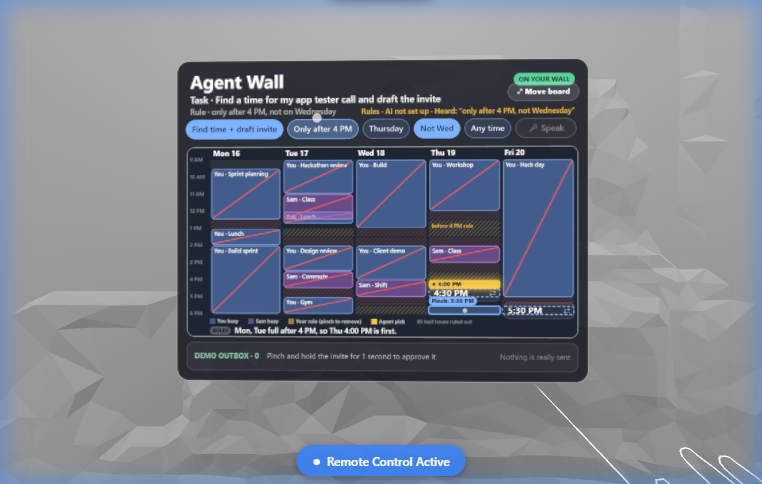
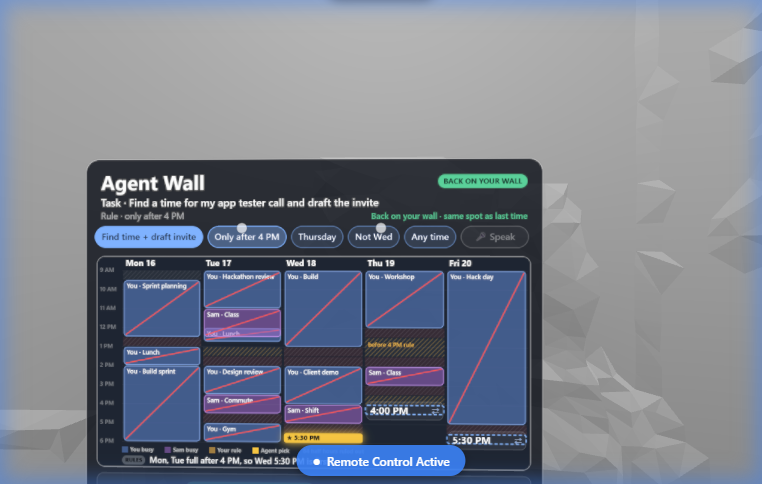
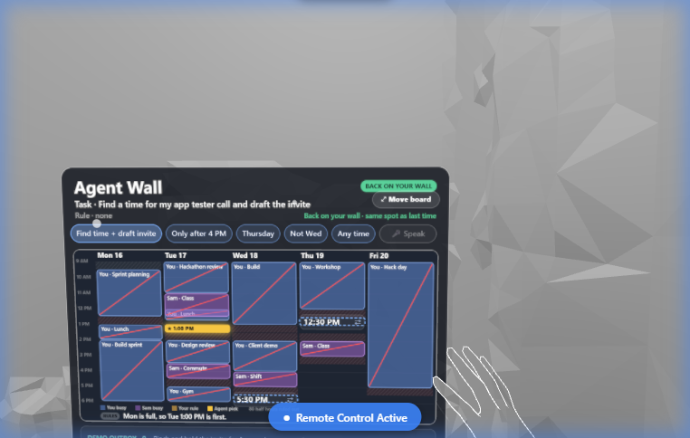

# Agent Wall

Your week on your real wall, the decision on your real desk. An AI agent plans a
task; when a time you approved stops fitting, you see why, try another time in
the room, and approve exactly what you see. Nothing goes out until you pinch and
hold, and Agent Wall itself sends nothing.

Entry for the Meta VR Start Developer Competition 2026 (Productivity track).
Built with Meta's [Immersive Web SDK](https://iwsdk.dev) (WebXR), hands only.

**Status: 16 Nov.** Real AI connected. **Tested on a real Quest** by steve40
(Meta forum, builds up to `e340f98`): wall placement, Move board and recenter
("Cool, it's perfect now"), the hold ring and its chime, and the palm-up gesture
("Open palm worked to reposition the board. No false triggers."). He heard no
agent voice; that was changed to recorded clips afterwards and has not been
confirmed on a headset. **Everything added since, including the conflict review
below, has run in Meta's emulator (IWER) only.** Frame rate on a Quest has not
been measured. **Have a Quest? Please try
[docs/TESTING-ON-QUEST.md](docs/TESTING-ON-QUEST.md).**

## The core interaction: an approved time stops fitting

You approved a call. Then your week changed. Agent Wall lets you **see why the
approved plan became wrong, try the replacement in the room, and approve the
exact version you looked at.** The wall holds the evidence across time; the desk
holds the decision.

1. **The change is on the wall.** A newer calendar snapshot overlaps the time you
   approved. The old time stays where it was, crossed out and labelled
   **CONFLICT**, beside the block that took it (marked NEW), with the real
   reason: "Tue 1:00 PM overlaps a new busy block". When only your own calendar
   is connected it also says **"Guest availability unknown"**. The old invite is
   **blocked at that moment**: on the desk it reads BLOCKED, and on the start
   page its email draft, calendar file and copy button are gone.
2. **Try a replacement in the room.** Two large targets (about 22 x 9 cm) offer
   other times the scheduler found: the nearest, and the same time of day on
   another day. Pinch one and a **preview** appears at the new time while the old
   conflict stays in view; a draft flies from that time to your desk and shows
   both times ("WAS Tue 1:00 PM → NOW Wed 5:30 PM") and **one computed
   trade-off** ("Last half hour of the workday", "Leaves 30 minutes before
   Sam's next event", "Moves the call 2 hours later"). Pinching the other
   target, or **Cancel**, changes nothing you approved.
3. **Hold to approve the replacement.** The card starts at NEEDS APPROVAL. One
   continuous pinch-and-hold approves the exact card shown; the ring says what
   it approves ("HOLD TO APPROVE · Wed 5:30 PM"). Letting go early, losing hand
   tracking, a new conflict or a new plan cancels the hold, and the pinch still
   down cannot carry on into another card. After the 5-second Unsend window the
   old item is **REPLACED**: it stays in the outbox and on the start page as
   history, with nothing to hand off. The new one can be handed to your own
   mail and calendar apps. Agent Wall sends nothing.

**Try it with no setup:** enter, and pinch **Try it** on the first card (or
**⟳ Try a calendar change** beside the outbox at any time). It is a labelled
example: the busy block is called "Client call (example change)", the bar says
EXAMPLE CHANGE, and when you had approved nothing yet the example's own approval
is marked "EXAMPLE approval, not held by you". The example goes through the same
check as a real calendar.

**One check for every calendar** (`src/logic/review.ts`, `revalidate`): the
example change, a newer `.ics` file, a re-read link, and again on the start page
at the moment an email draft, a calendar file or the copy button is used. A
failed re-read of a link keeps the last calendar and says "REFRESH FAILED" on
the wall and on the start page. There is no background polling.

**Say a limit:** during a review pinch 🎤 and say, for example, "Could we push it
past three o'clock?". The sentence only becomes a limit for the search. The
board says who understood it: **RULES** (the fixed parser) or **LIVE AI** (only
when the parser could not read it and the model's checked answer changed the
limit). Free times, collisions, approval and hand-off stay in code; the model
gets free times and first names, never event titles, addresses or links. With
no microphone, no network or an unclear sentence the two targets still work.

**What Agent Wall cannot do:** an email draft already open in your mail app, or
a calendar file you already added, is outside it. The start page says so on a
blocked item.

| The change on the wall: old time kept, the reason | Try a time: a preview, the old conflict stays |
| --- | --- |
|  |  |
| **One hold, and the ring says what it approves** | **The old item stays as history: REPLACED** |
|  |  |

Checked with real emulated hand pinches in Meta's emulator:
`node scripts/emu/review.mjs` (46 checks: blocking, the trial, cancel, an early
release, hand tracking lost mid-hold, a new conflict mid-hold, the fresh hold,
the start page before and after a reload, a second change, a spoken limit,
reduced motion, no room data) and in `tests/review.test.ts`. Not on a headset.

## Everything else it does

1. The app finds a wall and puts the board on it (or floats it 1.2 m in front
   of you if there is no wall).
2. **Ask the agent** by pinching a chip ("Find time + draft invite", "Only after
   4 PM", "Thursday", "Not Wed", "🎯 Focus 2 h") or pinch **🎤 Speak** and say it
   ("any time" clears your rules). The agent says what it did in one short
   sentence: recorded clips (`public/voice/`, made by `scripts/make-voice-clips.mjs`)
   played through Web Audio like the chimes, because Quest Browser's own speech
   voice stays silent (found by our Quest tester). 🔊 turns the voice off.
3. **The week mural:** the agent sweeps Mon–Fri across your wall. Every time it
   can't use is struck out with the reason (you busy, Sam busy, too close to a
   meeting, your rule). One slot lights up gold; the runner-ups are outlined,
   and you can pinch one to pick it yourself. If the pick has a catch, the card
   says so ("Trade-off: only 10 min after Sam's class").
   **The week is touchable:** point at any free half hour and pinch to move the
   invite there; point at an amber rule area ("before 4 PM rule", "not Wed
   rule") and pinch to remove that rule, and the agent re-plans in front of
   you; pinch a busy block and the board says why it can't be used. Your rules
   are saved and come back next time.
4. **The decision tray:** the invite lifts off the gold slot on the wall and
   **flies down to your real table** (or just above your lap if there is no
   table in reach). **Pinch and hold it for 1 second**
   to approve. You get **5 seconds to Unsend** (pinch again), then it goes to
   the **Demo outbox** with a receipt that says which part came from your
   rules, the AI and you. Nothing is really sent.
   **The agent's next step:** it then offers, one at a time, a 10-minute prep
   block before the call (green on your week) and a reminder to Sam an hour
   before. Each needs your pinch; it never adds anything on its own.
5. **When the week changes:** see "The core interaction" above. (Until 16 Nov a
   timed sample change showed a Re-plan card while the old approved invite stayed
   usable. Now the old invite is blocked the moment the change is known.)
6. **Same wall next time:** the board remembers which wall it was on and where.
   Next time you enter looking about the same way, it comes back to the same
   spot ("BACK ON YOUR WALL"); look clearly elsewhere and it centres on your
   view instead. Pinch **⤢ Move board** and look at a wall to put it somewhere
   else. **Palm up to call it:** hold either open hand with the palm toward your
   face for a second (a ring fills) and the board comes to where you look.
   (Quest's own system gesture is palm up *and pinch*, so a pinch never counts.)
   The plan and the demo outbox are saved in your browser too.
7. **A second task, same agent:** pinch **🎯 Focus 2 h** and the agent finds two
   free hours on *your* calendar only (in the sample week only Thursday has
   room), shows them on the week and puts a **calendar block** on your desk to
   hold-approve. Rules work the same way.

8. **Your morning queue:** when you enter, the agent says how many things need
   your OK today (the focus block, then the tester call). Pinch **Start**, hold
   each card on your desk, and the header ends on **"TODAY ✓ all clear · 1 day
   in a row"**. Come back tomorrow and the count goes up; miss a day and it
   starts again. The greeting follows the time of day. About two minutes.
9. **The agent learns, but only with your yes:** move its pick to another day
   (or later, or earlier) **twice**, and it asks "Make *not Tuesday* a rule?".
   Nothing changes until you pinch **Add rule**; say **No** and it does not ask
   that again. The rule shows on the week like any other and one pinch removes it.
10. **Fits what your device can see:** the app reads the headset's real view
    angles. Meta VR Glasses see about 70 x 66 degrees, a Quest 3 about 110 x 96,
    so a board that is close to you is shrunk until all of it is inside 80% of
    the view. When a card waits on your desk and the desk is out of view, an
    amber tab under the board says **"▼ The card is on your desk"**.
11. **Look and pinch:** on a device with eye tracking (Meta VR Glasses, Quest
    Pro) you look at a chip, a time or the card and pinch with your hand resting
    in your lap. This is IWSDK's own gaze + pinch (`gazeTracking`); the hints
    switch from "point your hand" to "look". On a Quest 3 or 3S, which have no
    eye tracking, the hand ray works as before.

12. **Your own calendar (optional):** on the start page, open **Use my own
    calendar** and give an `.ics` file, or your private iCal link from Google,
    Outlook or iCloud. The wall then shows **your** next five working days, in
    your own time zone, with repeating meetings expanded, and the board says
    "YOUR CALENDAR · read …" instead of "SAMPLE WEEK". You can also say who the
    call is with, what it is about and your first name; the invite uses them.
    **Back to the sample week** removes it from the browser again.
13. **What you approved, for real:** after you hold a card, the start page lists
    it under **Approved by you** with **Open email draft** (a `mailto:` link:
    the words you approved, in your own mail app), **Add to my calendar**
    (a real `.ics` file with the approved time and length) and **Copy text**.
    Agent Wall itself still sends nothing: the last click is yours, in your app.
14. **A third task, move a meeting:** point at one of your meetings on the week
    ("Pinch to move: Design review") and pinch. The agent asks first, then finds
    the nearest time the meeting fits on your calendar (a Wednesday 3 PM meeting
    goes to Wednesday 3:30 PM when that is free, not to the first gap of the
    week, and the reason line says only what was searched), shows it like any plan
    and puts a **calendar change** card on your desk. Rules such as "Only after
    4 PM" narrow the move. After your hold the meeting sits at its new time and
    the next task plans around it.

Items 12 to 14 were added on 16 Nov and are checked in Meta's emulator only
(`node scripts/emu/real-calendar.mjs`, 26 checks, with made-up `.ics` files through
the real file box, including a newer file that takes an approved time;
`node scripts/emu/move.mjs`, 13 checks). Not yet on a headset. Reading a
**link**: the deployed Worker read a real public Google calendar (all-day
holidays) on 16 Nov; a private calendar with timed meetings has not been read
through a link yet.

The calendar file of an approved item holds the **instant** you approved (UTC),
so it is the same moment on a device in any time zone. The sample week states
its zone (IST); your own calendar uses the wall clock of the machine that
approved. Items saved before 16 Nov keep the wall-clock time they were saved with.

Items 8 to 11 were added on 16 Nov and are checked in Meta's emulator only
(`node scripts/emu/new-features.mjs`, 25 checks), not yet on a headset. Look
and pinch needs the emulator's Meta VR Glasses device (set `dev.emulator.device`
to `metaVRGlasses` in `iwsdk.config.json`); with the Quest 3 device that part is
skipped. The emulator reports the same wide view (115 x 90 degrees) for both
devices, so the glasses' narrow view was checked with a test setting
(`window.agentwall.setFov(70, 66)`), not with a real pair of glasses.

Screenshots from Meta's Quest 3 emulator (IWER), not a real headset:

| The agent sweeps the week | The week mural, gold pick |
| --- | --- |
|  |  |
| **Invite on the real table: hold to approve** | **5 s to Unsend** |
|  |  |
| **Receipt: RULES / YOU / DEMO** | **Agent keeps watch: conflict + Re-plan?** |
|  |  |
| **Point at a rule: pinch to remove it** | **Point at any free time: pinch to pick it** |
|  |  |
| **Next session, another seat: same spot** | **Move board button, cursor anywhere on the board** |
|  |  |
| **Palm toward your face: the board comes to you** | **Focus 2 h: a calendar block on the desk** |
|  |  |

By default all calendar data is **sample data** (`src/data/sample-calendar.json`)
and the board says so, bottom left. The example change is synthetic too and
every place it shows says so. Whether the AI or the rules understood you is a
separate line. Your own calendar is read only if you set it up on the start page
(item 12). Either way **Agent Wall sends nothing**: approved cards go to a demo
outbox, and the start page hands the usable ones to your own mail and calendar
apps (item 13). **Start over** on the start page clears the board and the example.

What is kept and where, when you use your own calendar:

- In your browser only: the busy times and short titles of the next two working
  weeks, and the link if you gave one. The calendar text itself is not kept.
- A link is fetched through the Agent Wall Worker, because calendar hosts do not
  let a web page read them. The Worker fetches only `https` links on Google,
  Outlook and iCloud calendar hosts, follows no redirect off them, and keeps and
  logs nothing.
- The AI gets free times and the guest's name. It never gets your event titles
  (a unit test checks this).
- What the agent does not know: the other person's calendar (only yours is
  read), and who else is in a meeting you move. The cards say so.
- Not read: all-day entries, events marked free, cancelled events.

## Try it

Open the GitHub Pages link in the **Meta Quest Browser** and press
**Enter mixed reality**. Allow spatial data when asked. Quest uses the walls from
your Space Setup; without one, the board floats in front of you.

On a desktop browser you only see a 2D preview of the board.

## Develop

Needs Node 20.19+, 22.12+ or 24.

```bash
npm install
npm run dev          # dev server + Meta Quest 3 emulator (IWER) in a managed browser
npm test             # 301 unit tests (Vitest): placement, scheduler, agent checks, week, desk, receipt, conflict review
npm run typecheck
npm run build        # static site in dist/
```

Emulator checks (dev server must be running headless):

```bash
npx iwsdk dev up --headless --allow-browser-automation
node scripts/emu/review.mjs         # the conflict review, start to end (46 checks)
node scripts/emu/run.mjs            # placement, asking, approving, the desk (93 checks)
node scripts/emu/new-features.mjs   # queue, learned rule, view fit, look + pinch (19 checks)
node scripts/emu/real-calendar.mjs  # your own calendar, a newer file, a failed re-read (26 checks)
node scripts/emu/move.mjs           # move a meeting (13 checks)
npx iwsdk dev down
```

Do not edit source files while a suite runs: the dev server reloads the page.
`node scripts/emu/review-shots.mjs` takes close-up screenshots of the review;
`node scripts/emu/video-take.mjs` plays the demo video's sequence for a screen
recorder (see [docs/SUBMISSION.md](docs/SUBMISSION.md)). The live model is
checked on purpose only: `npx vitest run --config vitest.live.config.ts`.

## How the board finds a wall

- `src/logic/placement.ts`: plain TypeScript. Picks the vertical plane labelled
  `wall` (or unlabelled) that is 0.4–4 m away, within 60° of where you look, and
  big enough for the board. Doors, windows, screens and wall art are skipped.
  The board goes where your gaze meets the wall, a little below eye level,
  2 cm off the wall, kept inside the wall's edges.
- `src/logic/placement-controller.ts`: waits up to 2.5 s for a wall, then falls
  back to 1.2 m in front of you. A wall that shows up in the first 15 s still
  wins; after that the board stays put.
- `src/logic/same-wall.ts`: remembers the wall as a fingerprint (label, width,
  height, bottom edge) plus the board's distance from the wall's left end and
  its height. All measured in the room, not in session coordinates, so a new
  session from another spot still finds it. A wall that matches within 8 cm
  gets the board back on its old spot if that spot is within 15° of your gaze
  (after a headset recenter: wherever you look); two same-size
  walls are told apart by where you look. If the board first lands on another
  wall, it moves only when the remembered wall arrives late as a new plane, so
  turning your head never moves it. No WebXR anchors. Assumption, not yet
  checked on a Quest: Space Setup reports the same wall sizes every session.
- `src/board-system.ts`: the IWSDK system that feeds detected planes and the
  head pose into that logic and moves the board.

## Fixes from the first Quest test (15 Nov)

| What the tester saw | Cause | Fix |
| --- | --- | --- |
| Board "angled at 45 degrees to me" | Any wall within 60° of the gaze was allowed, so a wall seen side-on could win; any vertical plane not on a short deny-list counted as a wall | Only planes labelled `wall`; the board must face you within 40°; walls that face you score better |
| Board off-centre, "no way for me to adjust" it | The remembered spot was used even 20° to the side | Remembered spot only within 15° of your gaze; new **⤢ Move board** button (pinch, look at a wall for 3 s) |
| Recentering the headset moved the board to the side | Recenter moves the WebXR origin; nothing listened for the reference space `reset` event | On `reset`, the board goes back to its remembered spot in the room |
| Hard to see the pointer, aiming "requires extreme accuracy" | IWSDK only shows the ray's cursor on targets, and the board was not one; chips were small hit targets | The whole board is a (do-nothing) ray target, so the cursor shows everywhere on it; invisible hit areas round every button (chips +1.6 cm up and down, meeting halfway across the gaps) |

## How the agent plans

- `src/logic/scheduler.ts`: finds 30-minute times where you and the tester are
  both free, inside 9:00–18:00, on the half hour, with 10 minutes between
  meetings and at least 30 minutes' notice. Rules like "only after 4 PM" narrow
  the search. With the sample week, the default pick is Tue 1:00 PM; "only
  after 4 PM" gives Wed 5:30 PM.
- `src/logic/plan.ts`: the plan is two linked cards. The invite is always
  drafted from the chosen slot; any change rewrites it and resets approval.
- `src/ui/cards.ts`, `src/board.ts`: draw the cards on canvas textures.

## When an approved time stops fitting (code)

- `src/logic/review.ts`: the one check (`revalidate`) for every calendar and the
  hand-off boundary (`checkHandOff`); which busy times collide (`overlapsOf`: a
  real overlap, not the 10-minute gap rule; the approved event itself, back in
  your calendar under its own title, is not a conflict); the two candidates and
  the one trade-off line; the review state. A conflict stays until you replace
  the item; a replaced item is superseded for good.
- `src/logic/plan.ts` (`approve`): every approved item carries a mark of the
  exact words and time on the card (`reviewed`), the calendar it was approved on
  (`source`), the instant (`startUtc`), and the item it replaced (`replaces`).
  Stored words that no longer match the mark are blocked.
- `src/logic/example-change.ts`: snapshots A and B of the labelled example. The
  example blocks are saved with the board, so the conflict is still on the wall
  after a reload. Your own calendar never gets one.
- `src/logic/storage.ts`: an approved item read back keeps only checked fields;
  records from before 16 Nov are adopted (no kind, source or mark) and checked
  against the calendar like any other.
- `src/logic/hold.ts`: one continuous hold. A real release ends it (the next
  pinch starts from nothing); `cancel()` also makes the pinch still down wait.
- `src/logic/agent.ts` (`understandRule`): a sentence to a limit, by the rules
  when they can read it, by the live model only when they cannot.
- `src/sent.ts`: the start page list; blocked items have no link and no button,
  and their calendar-file links are revoked.
- `src/board-system.ts` (`recheck`, `beginReview`, `tryCandidate`,
  `cancelReview`, `approveNow`): the flow. `src/board.ts`, `src/ui/cards.ts`,
  `src/ui/mural.ts`: the bar, the two targets, the marks on the week, the card.

## The 16 Nov features

- `src/logic/ics.ts`: an `.ics` text to busy blocks (uses ical.js): time zones
  the file defines, repeats, moved and skipped occurrences, events across
  midnight. `src/logic/real-week.ts`: the next five working days and the
  calendar the agent plans on. `src/calendar-source.ts`: sample or yours, what
  is stored, the link check. `src/setup.ts`: the start page's box.
- `src/logic/handoff.ts`: the `mailto:` link and the `.ics` file for an approved
  card. `src/sent.ts`: the "Approved by you" list.
- `src/logic/move.ts`: which meeting is under a pinch, where else it fits, the
  calendar-change card, and the calendar after the move.
- `worker/src/index.ts` `POST /ics`: reads one calendar link (needs
  `npx wrangler deploy` in `worker/` to go live).

- `src/logic/queue.ts`: the morning queue. An item is ticked when its card
  really went out (after the Unsend window), whichever way you asked. The day
  count uses your own calendar day; stored data is never trusted (a date from
  the future starts a fresh queue).
- `src/logic/learn.ts`: your corrections of the agent's own picks (never of your
  own), the rule two agreeing corrections suggest, and the offers you declined.
- `src/logic/fov.ts`: view angles from the WebXR projection matrix, the scale
  that fits the board inside them, and whether a point is in view.
- `iwsdk.config.json` `gazeTracking`: an optional session feature. Where the
  browser does not offer it, nothing changes.
- All three logic files are unit-tested in `tests/new-features.test.ts`.

## How approval works

- `src/logic/hold.ts`: pinch-and-hold timer. 1 s to approve; ray flicker up to
  0.15 s is forgiven; letting go ends the hold (the ring drains so you see it,
  and the next pinch starts from nothing); after approving, the pinch must be
  released before anything can be approved again.
- `src/logic/plan.ts` (`approve`, `addToOutbox`, `unapprove`, `buildReceipt`):
  only an invite that needs approval and is linked to the shown slot can be
  approved. An approved invite sits in a 5 s Unsend window, then gets its
  RULES / AI / YOU receipt.
- `src/logic/desk.ts`: picks a horizontal plane labelled table or desk at
  0.55–1.15 m high and within 1 m reach for the invite; otherwise the lap spot.
- `src/board-system.ts`: IWSDK `RayInteractable` on the invite, the
  alternatives and the chips (pinch only: a finger-poke target on the desk card
  would take priority over the hand ray and block the chips). A pinch that starts
  on the invite keeps holding until the hand opens, even if the ray drifts off
  the card. In the desktop preview the mouse does the same.
- Every press captures the hand ray until the pinch opens. Without that,
  IWSDK 1.0.1 drops a release that ends on empty space (e.g. a pinched "Also
  free" pill moves away under the ray) and the next pinch is swallowed. Found
  and fixed with the emulator replay `scripts/emu/pinch-replay.mjs`.

## How the touchable week works

- `src/logic/touch-week.ts`: turns a pinch on the mural (day column + minute)
  into an action: pick that free time, remove the rule part that blocks it
  (`ruleKeyFor` in `week.ts`, the same code that writes the amber labels), or
  explain a busy block. Unit-tested.
- The mural is one canvas texture; the hand ray's hit (`uv`) is mapped back to
  the grid. Hovering lights up the free time, or every cell of the rule you
  would remove, with a "Pinch: 2:30 PM" / "Pinch to remove: after 4 PM" label.

## How the week mural is drawn

- `src/logic/week.ts`: for every half hour of the sample week, says why it can't
  be used (past, busy, buffer, rule) or that it is free; also finds the
  trade-off line for the chosen time.
- `src/ui/mural.ts`: draws the week on one canvas texture; the sweep animates
  over 1.8 s, then the gold pick and the runner-ups appear.

## The AI, and why the demo never breaks

The AI has one narrow job: turn what you said ("only after 4 PM") plus the
sample calendar into a slot choice and an email. It runs on Groq
(`qwen/qwen3.8-27b`, strict JSON schema) behind a small Cloudflare Worker (`worker/`), so the
API key never ships in the app.

- The app sends the AI only the free slots the scheduler computed; the AI must
  pick one of them.
- Every answer is checked (`src/logic/agent.ts`): a slot that breaks the rule
  is replaced, an email that names the wrong day or time, has links, or is too
  long is replaced by the template.
- If the AI takes more than 3 seconds, errors, or is offline, the rule-based
  scheduler answers instead. The board always says who planned it.
- Voice: the app records up to 5 s (`getUserMedia`), the Worker sends it to
  Whisper (`whisper-large-v3-turbo`). If the mic or the service fails, the
  chips still work.

### Set up the Worker (free)

1. Create a free Groq API key at https://console.groq.com/keys
2. In `worker/`: `npm install`, `npx wrangler login`,
   `npx wrangler secret put GROQ_API_KEY` (paste the key when asked), then
   `npx wrangler deploy`. It prints the Worker URL.
3. Set the URL as a repository variable and redeploy the site:
   `gh variable set AGENT_URL --body https://<your-worker>.workers.dev`
   then `gh workflow run "Test and deploy to GitHub Pages"`.

Without the Worker the app runs in rules mode, and the board says so.

## Performance notes

- Download: the main script is 2.4 MB (0.66 MB gzipped). IWSDK's UI kit pulls in
  a 4.1 MB icon set we never use; `vite.config.ts` swaps it for the two icons
  the kit needs (`src/stubs/uikit-lucide-lite.ts`).
- One draw call and one texture per panel; panels redraw only when their
  content changes. Desktop emulator: 16.7 ms frames (60 fps), no allocations
  in the frame loop. Not yet measured on a Quest.
- Far walls get a bigger board (up to 1.4x) so text stays readable.

## License

MIT
