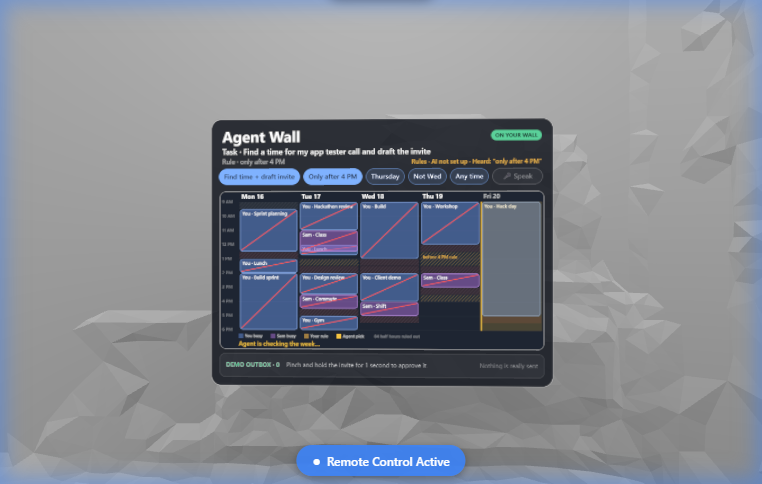
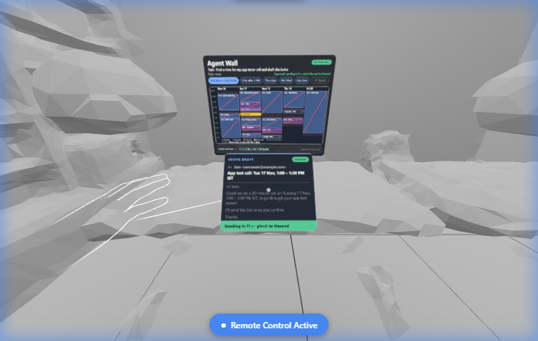
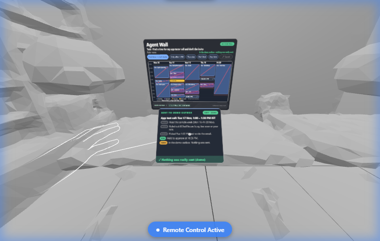

# Agent Wall

A mixed reality board on your real wall where an AI agent plans one real task,
and nothing goes out until you pinch and hold to approve.

Entry for the Meta VR Start Developer Competition 2026 (Productivity track).
Built with Meta's [Immersive Web SDK](https://iwsdk.dev) (WebXR), hands only.

**Status: 14 Nov, after Day 5.** Real AI connected; tested in Meta's Quest 3
emulator only, not yet on a real Quest. **Have a Quest? Please try the 10-step
checklist: [docs/TESTING-ON-QUEST.md](docs/TESTING-ON-QUEST.md).**

1. The app finds a wall and puts the board on it (or floats it 1.2 m in front
   of you if there is no wall).
2. **Ask the agent** by pinching a chip ("Find time + draft invite", "Only after
   4 PM", "Thursday", "Not Wed", "Any time") or pinch **🎤 Speak** and say it.
3. **The week mural:** the agent sweeps Mon–Fri across your wall. Every time it
   can't use is struck out with the reason (you busy, Sam busy, too close to a
   meeting, your rule). One slot lights up gold; the runner-ups are outlined,
   and you can pinch one to pick it yourself. If the pick has a catch, the card
   says so ("Trade-off: only 10 min after Sam's class").
4. **The decision tray:** the invite lands on your real table (or just above
   your lap if there is no table in reach). **Pinch and hold it for 1 second**
   to approve. You get **5 seconds to Unsend** (pinch again), then it goes to
   the **Demo outbox** with a receipt that says which part came from your
   rules, the AI and you. Nothing is really sent.
5. **The agent keeps watch:** a few seconds later a SAMPLE change lands on the
   approved time ("Dentist"). The mural shows it in red, the invite shows the
   conflict, and a **Re-plan?** card appears. Re-planning moves the invite to a
   new time, and it needs your hold again. The agent never re-sends on its own.
6. **Same wall next time:** the board remembers which wall it was on and where.
   Next time you enter, it comes back to the same spot ("BACK ON YOUR WALL"),
   even if you sit a little differently or look elsewhere. The plan and the
   demo outbox are saved in your browser too.

Screenshots from Meta's Quest 3 emulator (IWER), not a real headset:

| The agent sweeps the week | The week mural, gold pick |
| --- | --- |
|  |  |
| **Invite on the real table: hold to approve** | **5 s to Unsend** |
|  |  |
| **Receipt: RULES / YOU / DEMO** | **Agent keeps watch: conflict + Re-plan?** |
|  |  |
| **Next session, another seat: same spot** | |
|  | |

All calendar data is **sample data** (`src/data/sample-calendar.json`). Nothing
reads a real calendar and nothing is sent.

## Try it

Open the GitHub Pages link in the **Meta Quest Browser** and press
**Enter mixed reality**. Allow spatial data when asked. Quest uses the walls from
your Space Setup; without one, the board floats in front of you.

On a desktop browser you only see a 2D preview of the board.

## Develop

Needs Node 20.19+, 22.12+ or 24.

```bash
npm install
npm run dev          # dev server + Meta Quest 3 emulator (IWER) in a managed browser
npm test             # unit tests (Vitest): placement, scheduler, agent checks, week, desk, receipt
npm run typecheck
npm run build        # static site in dist/
```

Emulator checks (dev server must be running headless):

```bash
npx iwsdk dev up --headless --allow-browser-automation
node scripts/emu/run.mjs
npx iwsdk dev down
```

## How the board finds a wall

- `src/logic/placement.ts`: plain TypeScript. Picks the vertical plane labelled
  `wall` (or unlabelled) that is 0.4–4 m away, within 60° of where you look, and
  big enough for the board. Doors, windows, screens and wall art are skipped.
  The board goes where your gaze meets the wall, a little below eye level,
  2 cm off the wall, kept inside the wall's edges.
- `src/logic/placement-controller.ts`: waits up to 2.5 s for a wall, then falls
  back to 1.2 m in front of you. A wall that shows up in the first 15 s still
  wins; after that the board stays put.
- `src/logic/same-wall.ts`: remembers the wall as a fingerprint (label, width,
  height, bottom edge) plus the board's distance from the wall's left end and
  its height. All measured in the room, not in session coordinates, so a new
  session from another spot still finds it. A wall that matches within 8 cm
  and is in front (75°) gets the board back on its old spot; two same-size
  walls are told apart by where you look. If the board first lands on another
  wall, it moves only when the remembered wall arrives late as a new plane, so
  turning your head never moves it. No WebXR anchors. Assumption, not yet
  checked on a Quest: Space Setup reports the same wall sizes every session.
- `src/board-system.ts`: the IWSDK system that feeds detected planes and the
  head pose into that logic and moves the board.

## How the agent plans

- `src/logic/scheduler.ts`: finds 30-minute times where you and the tester are
  both free, inside 9:00–18:00, on the half hour, with 10 minutes between
  meetings and at least 30 minutes' notice. Rules like "only after 4 PM" narrow
  the search. With the sample week, the default pick is Tue 1:00 PM; "only
  after 4 PM" gives Wed 5:30 PM.
- `src/logic/plan.ts`: the plan is two linked cards. The invite is always
  drafted from the chosen slot; any change rewrites it and resets approval.
- `src/ui/cards.ts`, `src/board.ts`: draw the cards on canvas textures.

## How approval works

- `src/logic/hold.ts`: pinch-and-hold timer. 1 s to approve; ray flicker up to
  0.15 s is forgiven; letting go drains the ring; after approving, the pinch
  must be released before anything can be approved again.
- `src/logic/plan.ts` (`approve`, `addToOutbox`, `unapprove`, `buildReceipt`):
  only an invite that needs approval and is linked to the shown slot can be
  approved. An approved invite sits in a 5 s Unsend window, then gets its
  RULES / AI / YOU receipt.
- `src/logic/desk.ts`: picks a horizontal plane labelled table or desk at
  0.55–1.15 m high and within 1 m reach for the invite; otherwise the lap spot.
- `src/logic/watch.ts`: the SAMPLE change the agent notices after you approve.
- `src/board-system.ts`: IWSDK `RayInteractable` on the invite, the
  alternatives and the chips (pinch only: a finger-poke target on the desk card
  would take priority over the hand ray and block the chips). A pinch that starts
  on the invite keeps holding until the hand opens, even if the ray drifts off
  the card. In the desktop preview the mouse does the same.
- Every press captures the hand ray until the pinch opens. Without that,
  IWSDK 1.0.1 drops a release that ends on empty space (e.g. a pinched "Also
  free" pill moves away under the ray) and the next pinch is swallowed. Found
  and fixed with the emulator replay `scripts/emu/pinch-replay.mjs`.

## How the week mural is drawn

- `src/logic/week.ts`: for every half hour of the sample week, says why it can't
  be used (past, busy, buffer, rule) or that it is free; also finds the
  trade-off line for the chosen time.
- `src/ui/mural.ts`: draws the week on one canvas texture; the sweep animates
  over 1.8 s, then the gold pick and the runner-ups appear.

## The AI, and why the demo never breaks

The AI has one narrow job: turn what you said ("only after 4 PM") plus the
sample calendar into a slot choice and an email. It runs on Groq
(`qwen/qwen3.8-27b`, strict JSON schema) behind a small Cloudflare Worker (`worker/`), so the
API key never ships in the app.

- The app sends the AI only the free slots the scheduler computed; the AI must
  pick one of them.
- Every answer is checked (`src/logic/agent.ts`): a slot that breaks the rule
  is replaced, an email that names the wrong day or time, has links, or is too
  long is replaced by the template.
- If the AI takes more than 3 seconds, errors, or is offline, the rule-based
  scheduler answers instead. The board always says who planned it.
- Voice: the app records up to 5 s (`getUserMedia`), the Worker sends it to
  Whisper (`whisper-large-v3-turbo`). If the mic or the service fails, the
  chips still work.

### Set up the Worker (free)

1. Create a free Groq API key at https://console.groq.com/keys
2. In `worker/`: `npm install`, `npx wrangler login`,
   `npx wrangler secret put GROQ_API_KEY` (paste the key when asked), then
   `npx wrangler deploy`. It prints the Worker URL.
3. Set the URL as a repository variable and redeploy the site:
   `gh variable set AGENT_URL --body https://<your-worker>.workers.dev`
   then `gh workflow run "Test and deploy to GitHub Pages"`.

Without the Worker the app runs in rules mode, and the board says so.

## Performance notes

- Download: the main script is 2.4 MB (0.66 MB gzipped). IWSDK's UI kit pulls in
  a 4.1 MB icon set we never use; `vite.config.ts` swaps it for the two icons
  the kit needs (`src/stubs/uikit-lucide-lite.ts`).
- One draw call and one texture per panel; panels redraw only when their
  content changes. Desktop emulator: 16.7 ms frames (60 fps), no allocations
  in the frame loop. Not yet measured on a Quest.
- Far walls get a bigger board (up to 1.4x) so text stays readable.

## License

MIT
