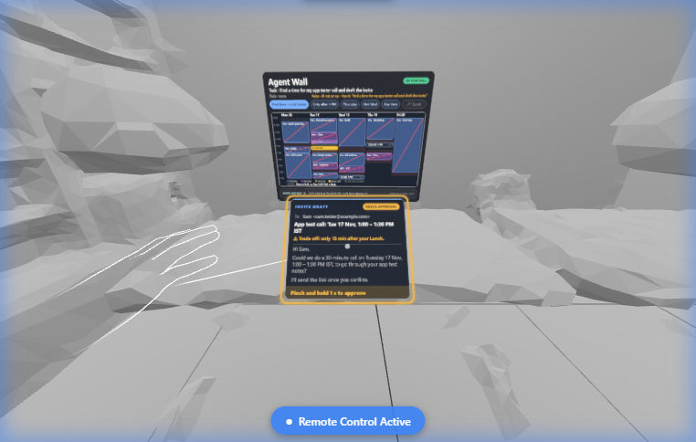
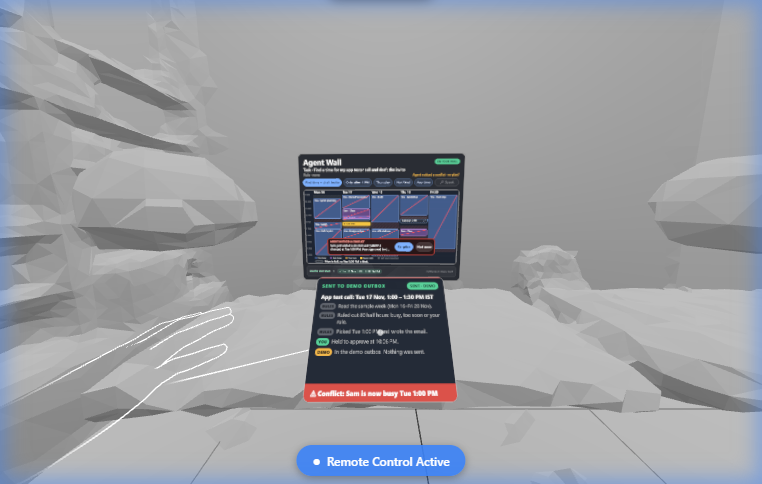
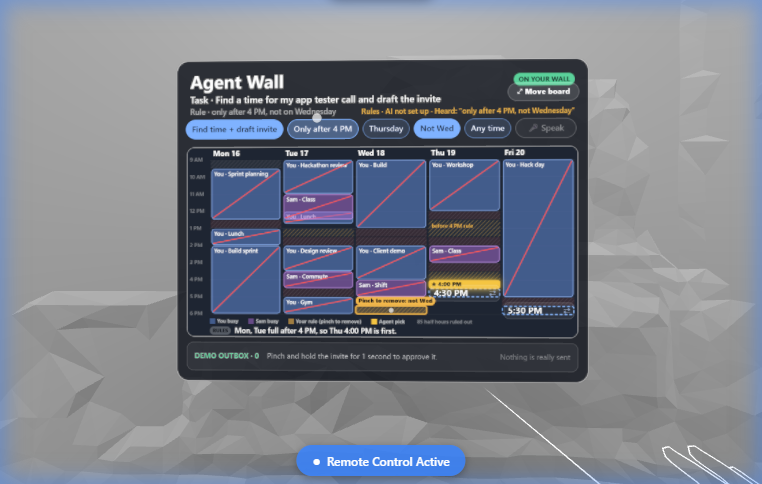
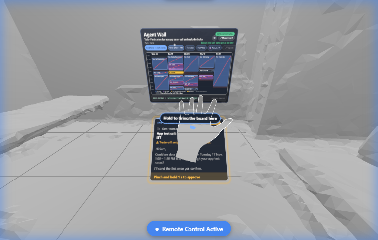
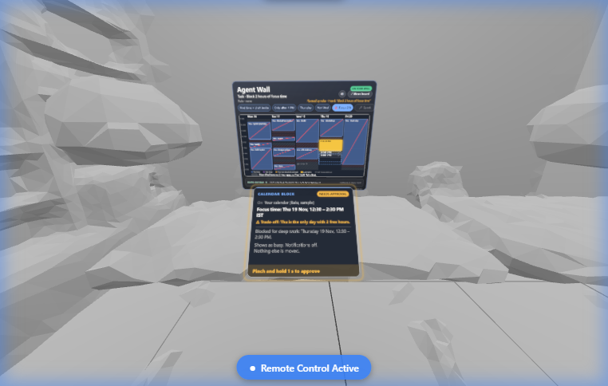

# Agent Wall

A mixed reality board on your real wall where an AI agent plans one real task,
and nothing goes out until you pinch and hold to approve.

Entry for the Meta VR Start Developer Competition 2026 (Productivity track).
Built with Meta's [Immersive Web SDK](https://iwsdk.dev) (WebXR), hands only.

**Status: 15 Nov.** Real AI connected. **Tested on a real Quest 3** by steve40
(Meta forum): after the fixes below he wrote "Cool, it's perfect now". The
features added later the same day (flight to the desk, next steps, voice, focus
time, palm-up summon) are tested in Meta's Quest 3 emulator, not yet on a
headset. **Have a Quest? Please try the 10-step
checklist: [docs/TESTING-ON-QUEST.md](docs/TESTING-ON-QUEST.md).**

1. The app finds a wall and puts the board on it (or floats it 1.2 m in front
   of you if there is no wall).
2. **Ask the agent** by pinching a chip ("Find time + draft invite", "Only after
   4 PM", "Thursday", "Not Wed", "🎯 Focus 2 h") or pinch **🎤 Speak** and say it
   ("any time" clears your rules). The agent says what it did in one short
   sentence: recorded clips (`public/voice/`, made by `scripts/make-voice-clips.mjs`)
   played through Web Audio like the chimes, because Quest Browser's own speech
   voice stays silent (found by our Quest tester). 🔊 turns the voice off.
3. **The week mural:** the agent sweeps Mon–Fri across your wall. Every time it
   can't use is struck out with the reason (you busy, Sam busy, too close to a
   meeting, your rule). One slot lights up gold; the runner-ups are outlined,
   and you can pinch one to pick it yourself. If the pick has a catch, the card
   says so ("Trade-off: only 10 min after Sam's class").
   **The week is touchable:** point at any free half hour and pinch to move the
   invite there; point at an amber rule area ("before 4 PM rule", "not Wed
   rule") and pinch to remove that rule, and the agent re-plans in front of
   you; pinch a busy block and the board says why it can't be used. Your rules
   are saved and come back next time.
4. **The decision tray:** the invite lifts off the gold slot on the wall and
   **flies down to your real table** (or just above your lap if there is no
   table in reach). **Pinch and hold it for 1 second**
   to approve. You get **5 seconds to Unsend** (pinch again), then it goes to
   the **Demo outbox** with a receipt that says which part came from your
   rules, the AI and you. Nothing is really sent.
   **The agent's next step:** it then offers, one at a time, a 10-minute prep
   block before the call (green on your week) and a reminder to Sam an hour
   before. Each needs your pinch; it never adds anything on its own.
5. **The agent keeps watch:** a few seconds later a SAMPLE change lands on the
   approved time ("Dentist"). The mural shows it in red, the invite shows the
   conflict, and a **Re-plan?** card appears. Re-planning moves the invite to a
   new time, and it needs your hold again. The agent never re-sends on its own.
6. **Same wall next time:** the board remembers which wall it was on and where.
   Next time you enter looking about the same way, it comes back to the same
   spot ("BACK ON YOUR WALL"); look clearly elsewhere and it centres on your
   view instead. Pinch **⤢ Move board** and look at a wall to put it somewhere
   else. **Palm up to call it:** hold either open hand with the palm toward your
   face for a second (a ring fills) and the board comes to where you look.
   (Quest's own system gesture is palm up *and pinch*, so a pinch never counts.)
   The plan and the demo outbox are saved in your browser too.
7. **A second task, same agent:** pinch **🎯 Focus 2 h** and the agent finds two
   free hours on *your* calendar only (in the sample week only Thursday has
   room), shows them on the week and puts a **calendar block** on your desk to
   hold-approve. Rules work the same way.

8. **Your morning queue:** when you enter, the agent says how many things need
   your OK today (the focus block, then the tester call). Pinch **Start**, hold
   each card on your desk, and the header ends on **"TODAY ✓ all clear · 1 day
   in a row"**. Come back tomorrow and the count goes up; miss a day and it
   starts again. The greeting follows the time of day. About two minutes.
9. **The agent learns, but only with your yes:** move its pick to another day
   (or later, or earlier) **twice**, and it asks "Make *not Tuesday* a rule?".
   Nothing changes until you pinch **Add rule**; say **No** and it does not ask
   that again. The rule shows on the week like any other and one pinch removes it.
10. **Fits what your device can see:** the app reads the headset's real view
    angles. Meta VR Glasses see about 70 x 66 degrees, a Quest 3 about 110 x 96,
    so a board that is close to you is shrunk until all of it is inside 80% of
    the view. When a card waits on your desk and the desk is out of view, an
    amber tab under the board says **"▼ The card is on your desk"**.
11. **Look and pinch:** on a device with eye tracking (Meta VR Glasses, Quest
    Pro) you look at a chip, a time or the card and pinch with your hand resting
    in your lap. This is IWSDK's own gaze + pinch (`gazeTracking`); the hints
    switch from "point your hand" to "look". On a Quest 3 or 3S, which have no
    eye tracking, the hand ray works as before.

12. **Your own calendar (optional):** on the start page, open **Use my own
    calendar** and give an `.ics` file, or your private iCal link from Google,
    Outlook or iCloud. The wall then shows **your** next five working days, in
    your own time zone, with repeating meetings expanded, and the board says
    "YOUR CALENDAR · read …" instead of "SAMPLE WEEK". You can also say who the
    call is with, what it is about and your first name; the invite uses them.
    **Back to the sample week** removes it from the browser again.
13. **What you approved, for real:** after you hold a card, the start page lists
    it under **Approved by you** with **Open email draft** (a `mailto:` link:
    the words you approved, in your own mail app), **Add to my calendar**
    (a real `.ics` file with the approved time and length) and **Copy text**.
    Agent Wall itself still sends nothing: the last click is yours, in your app.
14. **A third task, move a meeting:** point at one of your meetings on the week
    ("Pinch to move: Design review") and pinch. The agent asks first, then finds
    the nearest time the meeting fits on your calendar, shows it like any plan
    and puts a **calendar change** card on your desk. Rules such as "Only after
    4 PM" narrow the move. After your hold the meeting sits at its new time and
    the next task plans around it.

Items 12 to 14 were added on 16 Nov and are checked in Meta's emulator only
(`node scripts/emu/real-calendar.mjs`, 15 checks, with a made-up `.ics` through
the real file box; `node scripts/emu/move.mjs`, 13 checks). Not yet on a
headset, and reading a **link** has only been tested against a fake calendar
host, not against a real Google, Outlook or iCloud link.

Items 8 to 11 were added on 16 Nov and are checked in Meta's emulator only
(`node scripts/emu/new-features.mjs`, 25 checks), not yet on a headset. Look
and pinch needs the emulator's Meta VR Glasses device (set `dev.emulator.device`
to `metaVRGlasses` in `iwsdk.config.json`); with the Quest 3 device that part is
skipped. The emulator reports the same wide view (115 x 90 degrees) for both
devices, so the glasses' narrow view was checked with a test setting
(`window.agentwall.setFov(70, 66)`), not with a real pair of glasses.

Screenshots from Meta's Quest 3 emulator (IWER), not a real headset:

| The agent sweeps the week | The week mural, gold pick |
| --- | --- |
|  |  |
| **Invite on the real table: hold to approve** | **5 s to Unsend** |
|  |  |
| **Receipt: RULES / YOU / DEMO** | **Agent keeps watch: conflict + Re-plan?** |
|  |  |
| **Point at a rule: pinch to remove it** | **Point at any free time: pinch to pick it** |
|  |  |
| **Next session, another seat: same spot** | **Move board button, cursor anywhere on the board** |
|  |  |
| **Palm toward your face: the board comes to you** | **Focus 2 h: a calendar block on the desk** |
|  |  |

By default all calendar data is **sample data** (`src/data/sample-calendar.json`)
and the board says so. Your own calendar is read only if you set it up on the
start page (item 12). Either way **Agent Wall sends nothing**: approved cards go
to a demo outbox, and the start page hands them to your own mail and calendar
apps (item 13).

What is kept and where, when you use your own calendar:

- In your browser only: the busy times and short titles of the next two working
  weeks, and the link if you gave one. The calendar text itself is not kept.
- A link is fetched through the Agent Wall Worker, because calendar hosts do not
  let a web page read them. The Worker fetches only `https` links on Google,
  Outlook and iCloud calendar hosts, follows no redirect off them, and keeps and
  logs nothing.
- The AI gets free times and the guest's name. It never gets your event titles
  (a unit test checks this).
- What the agent does not know: the other person's calendar (only yours is
  read), and who else is in a meeting you move. The cards say so.
- Not read: all-day entries, events marked free, cancelled events.

## Try it

Open the GitHub Pages link in the **Meta Quest Browser** and press
**Enter mixed reality**. Allow spatial data when asked. Quest uses the walls from
your Space Setup; without one, the board floats in front of you.

On a desktop browser you only see a 2D preview of the board.

## Develop

Needs Node 20.19+, 22.12+ or 24.

```bash
npm install
npm run dev          # dev server + Meta Quest 3 emulator (IWER) in a managed browser
npm test             # unit tests (Vitest): placement, scheduler, agent checks, week, desk, receipt
npm run typecheck
npm run build        # static site in dist/
```

Emulator checks (dev server must be running headless):

```bash
npx iwsdk dev up --headless --allow-browser-automation
node scripts/emu/run.mjs            # the core flow (93 checks)
node scripts/emu/new-features.mjs   # queue, learned rule, view fit, look + pinch
node scripts/emu/real-calendar.mjs  # your own calendar, "Approved by you"
node scripts/emu/move.mjs           # move a meeting
npx iwsdk dev down
```

## How the board finds a wall

- `src/logic/placement.ts`: plain TypeScript. Picks the vertical plane labelled
  `wall` (or unlabelled) that is 0.4–4 m away, within 60° of where you look, and
  big enough for the board. Doors, windows, screens and wall art are skipped.
  The board goes where your gaze meets the wall, a little below eye level,
  2 cm off the wall, kept inside the wall's edges.
- `src/logic/placement-controller.ts`: waits up to 2.5 s for a wall, then falls
  back to 1.2 m in front of you. A wall that shows up in the first 15 s still
  wins; after that the board stays put.
- `src/logic/same-wall.ts`: remembers the wall as a fingerprint (label, width,
  height, bottom edge) plus the board's distance from the wall's left end and
  its height. All measured in the room, not in session coordinates, so a new
  session from another spot still finds it. A wall that matches within 8 cm
  gets the board back on its old spot if that spot is within 15° of your gaze
  (after a headset recenter: wherever you look); two same-size
  walls are told apart by where you look. If the board first lands on another
  wall, it moves only when the remembered wall arrives late as a new plane, so
  turning your head never moves it. No WebXR anchors. Assumption, not yet
  checked on a Quest: Space Setup reports the same wall sizes every session.
- `src/board-system.ts`: the IWSDK system that feeds detected planes and the
  head pose into that logic and moves the board.

## Fixes from the first Quest test (15 Nov)

| What the tester saw | Cause | Fix |
| --- | --- | --- |
| Board "angled at 45 degrees to me" | Any wall within 60° of the gaze was allowed, so a wall seen side-on could win; any vertical plane not on a short deny-list counted as a wall | Only planes labelled `wall`; the board must face you within 40°; walls that face you score better |
| Board off-centre, "no way for me to adjust" it | The remembered spot was used even 20° to the side | Remembered spot only within 15° of your gaze; new **⤢ Move board** button (pinch, look at a wall for 3 s) |
| Recentering the headset moved the board to the side | Recenter moves the WebXR origin; nothing listened for the reference space `reset` event | On `reset`, the board goes back to its remembered spot in the room |
| Hard to see the pointer, aiming "requires extreme accuracy" | IWSDK only shows the ray's cursor on targets, and the board was not one; chips were small hit targets | The whole board is a (do-nothing) ray target, so the cursor shows everywhere on it; invisible hit areas round every button (chips +1.6 cm up and down, meeting halfway across the gaps) |

## How the agent plans

- `src/logic/scheduler.ts`: finds 30-minute times where you and the tester are
  both free, inside 9:00–18:00, on the half hour, with 10 minutes between
  meetings and at least 30 minutes' notice. Rules like "only after 4 PM" narrow
  the search. With the sample week, the default pick is Tue 1:00 PM; "only
  after 4 PM" gives Wed 5:30 PM.
- `src/logic/plan.ts`: the plan is two linked cards. The invite is always
  drafted from the chosen slot; any change rewrites it and resets approval.
- `src/ui/cards.ts`, `src/board.ts`: draw the cards on canvas textures.

## The 16 Nov features

- `src/logic/ics.ts`: an `.ics` text to busy blocks (uses ical.js): time zones
  the file defines, repeats, moved and skipped occurrences, events across
  midnight. `src/logic/real-week.ts`: the next five working days and the
  calendar the agent plans on. `src/calendar-source.ts`: sample or yours, what
  is stored, the link check. `src/setup.ts`: the start page's box.
- `src/logic/handoff.ts`: the `mailto:` link and the `.ics` file for an approved
  card. `src/sent.ts`: the "Approved by you" list.
- `src/logic/move.ts`: which meeting is under a pinch, where else it fits, the
  calendar-change card, and the calendar after the move.
- `worker/src/index.ts` `POST /ics`: reads one calendar link (needs
  `npx wrangler deploy` in `worker/` to go live).

- `src/logic/queue.ts`: the morning queue. An item is ticked when its card
  really went out (after the Unsend window), whichever way you asked. The day
  count uses your own calendar day; stored data is never trusted (a date from
  the future starts a fresh queue).
- `src/logic/learn.ts`: your corrections of the agent's own picks (never of your
  own), the rule two agreeing corrections suggest, and the offers you declined.
- `src/logic/fov.ts`: view angles from the WebXR projection matrix, the scale
  that fits the board inside them, and whether a point is in view.
- `iwsdk.config.json` `gazeTracking`: an optional session feature. Where the
  browser does not offer it, nothing changes.
- All three logic files are unit-tested in `tests/new-features.test.ts`.

## How approval works

- `src/logic/hold.ts`: pinch-and-hold timer. 1 s to approve; ray flicker up to
  0.15 s is forgiven; letting go drains the ring; after approving, the pinch
  must be released before anything can be approved again.
- `src/logic/plan.ts` (`approve`, `addToOutbox`, `unapprove`, `buildReceipt`):
  only an invite that needs approval and is linked to the shown slot can be
  approved. An approved invite sits in a 5 s Unsend window, then gets its
  RULES / AI / YOU receipt.
- `src/logic/desk.ts`: picks a horizontal plane labelled table or desk at
  0.55–1.15 m high and within 1 m reach for the invite; otherwise the lap spot.
- `src/logic/watch.ts`: the SAMPLE change the agent notices after you approve.
- `src/board-system.ts`: IWSDK `RayInteractable` on the invite, the
  alternatives and the chips (pinch only: a finger-poke target on the desk card
  would take priority over the hand ray and block the chips). A pinch that starts
  on the invite keeps holding until the hand opens, even if the ray drifts off
  the card. In the desktop preview the mouse does the same.
- Every press captures the hand ray until the pinch opens. Without that,
  IWSDK 1.0.1 drops a release that ends on empty space (e.g. a pinched "Also
  free" pill moves away under the ray) and the next pinch is swallowed. Found
  and fixed with the emulator replay `scripts/emu/pinch-replay.mjs`.

## How the touchable week works

- `src/logic/touch-week.ts`: turns a pinch on the mural (day column + minute)
  into an action: pick that free time, remove the rule part that blocks it
  (`ruleKeyFor` in `week.ts`, the same code that writes the amber labels), or
  explain a busy block. Unit-tested.
- The mural is one canvas texture; the hand ray's hit (`uv`) is mapped back to
  the grid. Hovering lights up the free time, or every cell of the rule you
  would remove, with a "Pinch: 2:30 PM" / "Pinch to remove: after 4 PM" label.

## How the week mural is drawn

- `src/logic/week.ts`: for every half hour of the sample week, says why it can't
  be used (past, busy, buffer, rule) or that it is free; also finds the
  trade-off line for the chosen time.
- `src/ui/mural.ts`: draws the week on one canvas texture; the sweep animates
  over 1.8 s, then the gold pick and the runner-ups appear.

## The AI, and why the demo never breaks

The AI has one narrow job: turn what you said ("only after 4 PM") plus the
sample calendar into a slot choice and an email. It runs on Groq
(`qwen/qwen3.8-27b`, strict JSON schema) behind a small Cloudflare Worker (`worker/`), so the
API key never ships in the app.

- The app sends the AI only the free slots the scheduler computed; the AI must
  pick one of them.
- Every answer is checked (`src/logic/agent.ts`): a slot that breaks the rule
  is replaced, an email that names the wrong day or time, has links, or is too
  long is replaced by the template.
- If the AI takes more than 3 seconds, errors, or is offline, the rule-based
  scheduler answers instead. The board always says who planned it.
- Voice: the app records up to 5 s (`getUserMedia`), the Worker sends it to
  Whisper (`whisper-large-v3-turbo`). If the mic or the service fails, the
  chips still work.

### Set up the Worker (free)

1. Create a free Groq API key at https://console.groq.com/keys
2. In `worker/`: `npm install`, `npx wrangler login`,
   `npx wrangler secret put GROQ_API_KEY` (paste the key when asked), then
   `npx wrangler deploy`. It prints the Worker URL.
3. Set the URL as a repository variable and redeploy the site:
   `gh variable set AGENT_URL --body https://<your-worker>.workers.dev`
   then `gh workflow run "Test and deploy to GitHub Pages"`.

Without the Worker the app runs in rules mode, and the board says so.

## Performance notes

- Download: the main script is 2.4 MB (0.66 MB gzipped). IWSDK's UI kit pulls in
  a 4.1 MB icon set we never use; `vite.config.ts` swaps it for the two icons
  the kit needs (`src/stubs/uikit-lucide-lite.ts`).
- One draw call and one texture per panel; panels redraw only when their
  content changes. Desktop emulator: 16.7 ms frames (60 fps), no allocations
  in the frame loop. Not yet measured on a Quest.
- Far walls get a bigger board (up to 1.4x) so text stays readable.

## License

MIT
